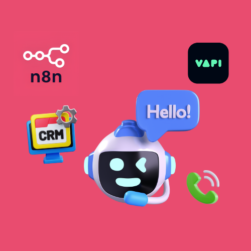
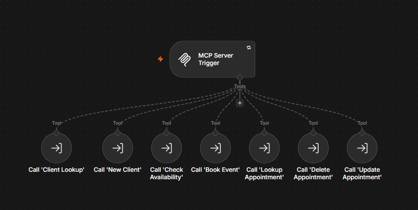
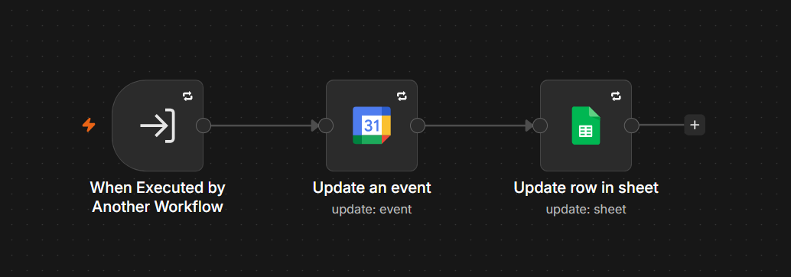
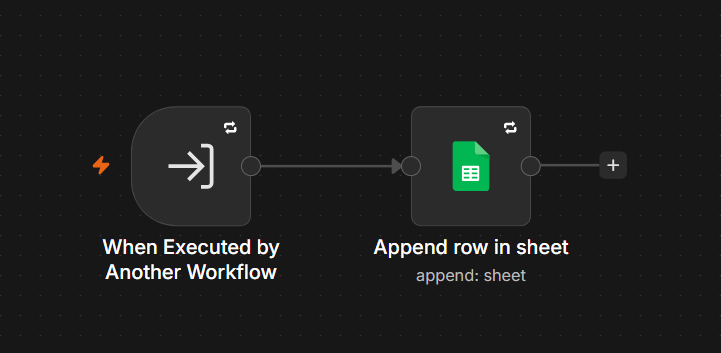
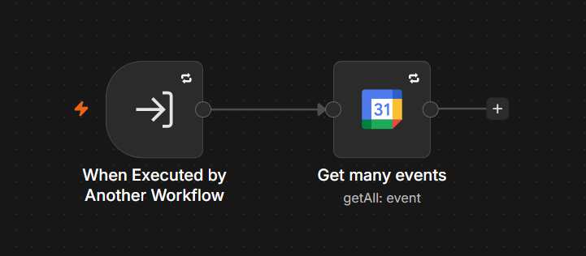
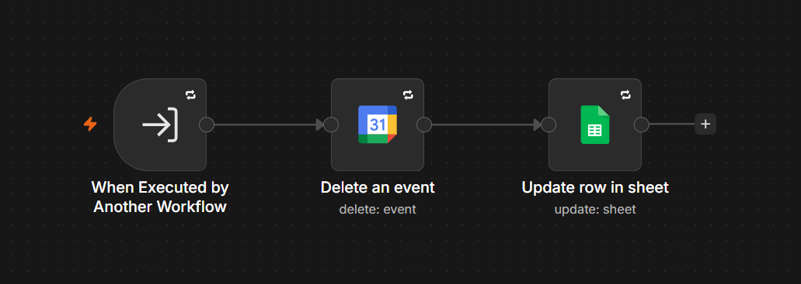
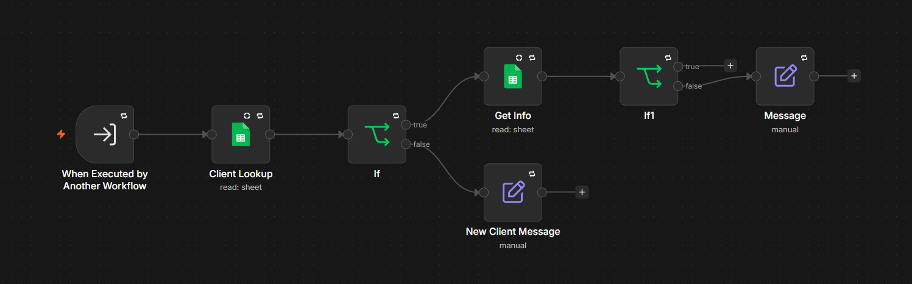
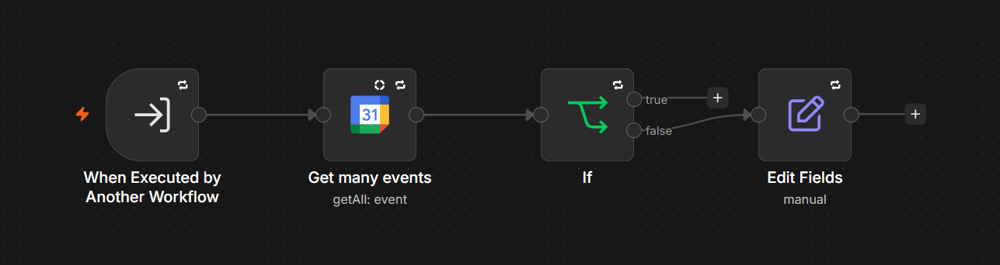
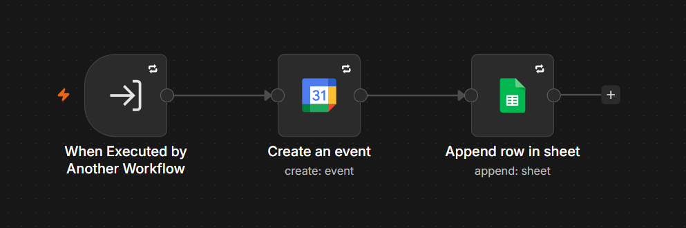
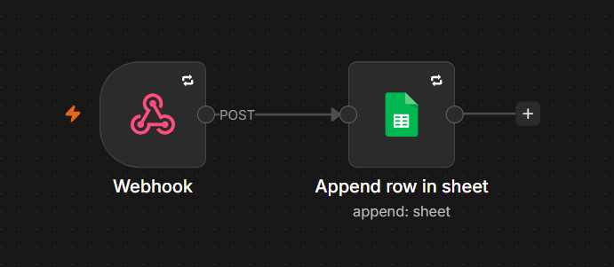

# AI Voice Assistant for Appointment Scheduling and CRM with Vapi and n8n

This project connects a Vapi voice assistant to n8n workflows that book, move, and cancel appointments in Google Calendar and keep client records in Google Sheets. An n8n MCP server exposes seven sub-workflows as tools, and a separate webhook workflow stores call transcripts.

## Overview

The Vapi voice assistant calls an **MCP server** hosted in n8n through an MCP Server Trigger node. The server lists seven tools, and each tool runs one sub-workflow with values the AI extracts from the conversation. The sub-workflows read and write Google Calendar events and rows in a Google Sheets spreadsheet that serves as the CRM.

The spreadsheet holds three worksheets: Clients, Appointment Log, and Call Log. A ninth workflow runs on its own and receives a POST request from Vapi when a call ends, then writes the transcript to the Call Log worksheet.

Vapi MCP Server workflow:

Vapi Update Appointment workflow:

Vapi New Client workflow:

Vapi Lookup Appointment workflow:

Vapi Delete Appointment workflow:

Vapi Client Lookup workflow:

Vapi Check Availability workflow:

Vapi Book Event workflow:

Vapi End of Call Report workflow:

## Workflows

| Workflow | Trigger | Purpose |
| --- | --- | --- |
| Vapi MCP Server | MCP Server Trigger | Exposes the seven appointment and CRM sub-workflows as tools for the Vapi assistant. |
| Vapi Client Lookup | Called by the MCP server | Checks whether a client email exists in the CRM and whether the client has past appointments. |
| Vapi New Client | Called by the MCP server | Adds a client to the Clients worksheet. |
| Vapi Check Availability | Called by the MCP server | Checks Google Calendar for events inside a time window. |
| Vapi Book Event | Called by the MCP server | Creates a Google Calendar event and logs it in the Appointment Log worksheet. |
| Vapi Lookup Appointment | Called by the MCP server | Returns Google Calendar events inside a time window. |
| Vapi Update Appointment | Called by the MCP server | Changes the start and end time of an event and records the move in the Appointment Log worksheet. |
| Vapi Delete Appointment | Called by the MCP server | Deletes a Google Calendar event and marks its row as canceled. |
| Vapi End of Call Report | Webhook (POST) | Stores the call transcript in the Call Log worksheet. |

## Workflow Details

### Vapi MCP Server

This workflow gives the Vapi assistant a single entry point to every appointment and CRM operation.

Trigger: an MCP Server Trigger node that Vapi connects to.

1. The trigger lists seven tool nodes, each of which runs one sub-workflow.
2. Each tool node has a description that tells the AI when to use it, and the AI fills the inputs from the conversation.
3. The tools are Client Lookup (email), New Client (email, full name, phone number), Check Availability (start and end of the window), Book Event (start time, end time, email, event summary), Lookup Appointment (start and end of the window), Update Appointment (start time, end time, event ID), and Delete Appointment (event ID).
4. The Lookup Appointment description requires the AI to call it before deleting or updating an appointment.

Integrations: Vapi.

### Vapi Client Lookup

This workflow tells the assistant whether a caller is a known client and whether they have booked before.

Trigger: an Execute Workflow Trigger that receives an email address.

1. A Google Sheets node searches the Clients worksheet for the email.
2. An If node checks whether a matching record exists.
3. When no record exists, the New Client Message node sets a message saying the client is not in the CRM.
4. When a record exists, a second Google Sheets node reads the Appointment Log worksheet for rows with that email.
5. A second If node checks whether any appointment rows exist.
6. When none exist, the Message node sets a message saying the client is in the CRM with no previous appointments. When rows exist, the workflow ends there.

Integrations: Google Sheets.

### Vapi New Client

This workflow registers a new client in the CRM.

Trigger: an Execute Workflow Trigger that receives an email, a full name, and a phone number.

1. A Google Sheets node appends a row to the Clients worksheet with the email, name, and phone number.

Integrations: Google Sheets.

### Vapi Check Availability

This workflow reports whether a time window is free.

Trigger: an Execute Workflow Trigger that receives the start and end of the window.

1. A Google Calendar node retrieves all events between the two times and still returns an item when there are none.
2. An If node checks whether the returned item has an event summary.
3. When the item has a summary, the true branch has no further node, so the workflow returns no availability message.
4. When the item has no summary, an Edit Fields node sets a message stating that the entire day is available.

Integrations: Google Calendar.

### Vapi Book Event

This workflow books an appointment and records it in the CRM.

Trigger: an Execute Workflow Trigger that receives a start time, an end time, an email, and an event summary.

1. A Google Calendar node creates an event with the given times and summary and adds the email as an attendee.
2. A Google Sheets node appends a row to the Appointment Log worksheet with the email, appointment type, start date, a booked note, and the new event ID.

Integrations: Google Calendar, Google Sheets.

### Vapi Lookup Appointment

This workflow lists the appointments in a time window.

Trigger: an Execute Workflow Trigger that receives the start and end of the window.

1. A Google Calendar node retrieves all events between the two times.

Integrations: Google Calendar.

### Vapi Update Appointment

This workflow reschedules an appointment and logs the change.

Trigger: an Execute Workflow Trigger that receives a start time, an end time, and an event ID.

1. A Google Calendar node updates the event with the new start and end times.
2. A Google Sheets node finds the row in the Appointment Log worksheet by event ID, sets the date to the new start time, and writes a note that records the new time.

Integrations: Google Calendar, Google Sheets.

### Vapi Delete Appointment

This workflow cancels an appointment and keeps its record.

Trigger: an Execute Workflow Trigger that receives an event ID.

1. A Google Calendar node deletes the event.
2. A Google Sheets node finds the row in the Appointment Log worksheet by event ID, sets the date to the event's original start time, and writes a canceled note.

Integrations: Google Calendar, Google Sheets.

### Vapi End of Call Report

This workflow keeps a transcript of every call.

Trigger: a Webhook node that accepts POST requests from Vapi.

1. A Google Sheets node appends a row to the Call Log worksheet with the current date and time and the transcript from the request body.

Integrations: Vapi, Google Sheets.

## Integrations

- Vapi
- Google Calendar
- Google Sheets
- Model Context Protocol (through the n8n MCP Server Trigger)

## Prerequisites

- An n8n instance that includes the MCP Server Trigger and Tool Workflow nodes.
- A Google Calendar OAuth2 credential with permission to read, create, update, and delete events.
- A Google Sheets OAuth2 credential with permission to read, append, and update rows.
- A Google Sheets spreadsheet with a Clients worksheet (Email, Name, Phone), an Appointment Log worksheet (ID, Email, Appointment Type, Date, Notes), and a Call Log worksheet (Date, Transcript).
- A Vapi account that can connect to an MCP server and send a webhook request at the end of a call.

## Setup

1. Create the spreadsheet with the three worksheets and column headers listed in Prerequisites.
2. Import every JSON file from the `workflows` directory into n8n.
3. Create the Google Calendar OAuth2 and Google Sheets OAuth2 credentials in n8n.
4. Assign the credentials to the Google Calendar and Google Sheets nodes in each workflow.
5. Select your spreadsheet, worksheets, and calendar in every Google Sheets and Google Calendar node.
6. Open Vapi MCP Server and point each tool node at its imported sub-workflow.
7. Activate all nine workflows.
8. In Vapi, connect the assistant to the MCP Server Trigger endpoint and set the End of Call Report webhook endpoint as the end-of-call destination.
